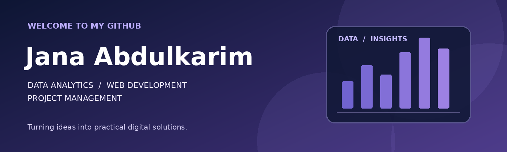
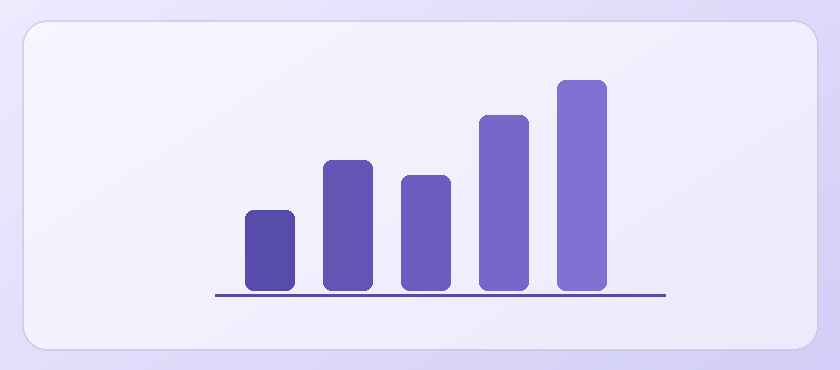

---

## About Me

I enjoy turning complex information into clear insights, building practical digital experiences, and coordinating projects from planning through delivery.

My main interests are **data analytics**, **web development**, and **project management**, with a growing interest in applied **AI & machine learning**.

## What I Do

| 📊 Analyze Data | 💻 Build Solutions | 📋 Manage Projects |
| :--- | :--- | :--- |
| Data analysis, visualization & insights | Practical, user-focused web applications | Planning, coordination, KPIs & reporting |

## Tools & Technologies

**📊 Data & Analytics**

**💻 Web Development**

**🔧 Workflow**

## Featured Work

<table>
<tr>
<td width="33%" valign="top">

<b>Hassin | Cloud Clinic</b>

Collaborative workplace wellbeing platform featuring burnout assessment, analytics, and digital support services.

React · TypeScript · Supabase · Vercel

<a href="https://github.com/janaabdulkarim-stack/haseen-project">View Project →</a>

</td>

<td width="33%" valign="top">

<b>Data Analytics</b>

A space for documented data analysis and visualization projects.

Projects to be added

</td>

<td width="33%" valign="top">

<b>Web Development</b>

A space for practical, user-focused web applications.

Projects to be added

</td>
</tr>
</table>

---

## Currently Exploring

- Advanced Data Analytics & Visualization
- Modern Web Development
- Practical AI & Machine Learning Applications
- Data-driven Project Management

---

### Let's Connect

I'm always interested in learning, building, and collaborating on meaningful technology projects.

 

<i>Analyze data. Build solutions. Create impact.</i>

